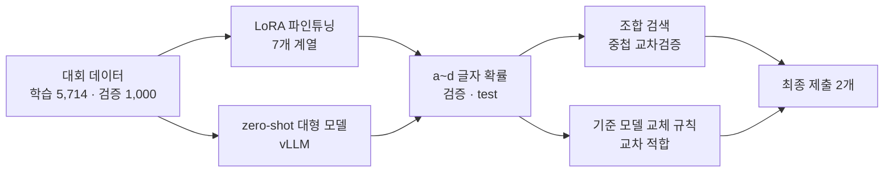

# 텍스트 이미지 VQA — SSAFY 16기 2회차 AI 챌린지 (A084 팀)

이미지 + 한국어 질문 + 보기 4개를 받아 a~d 중 하나를 고르는 4지선다 VQA 대회의 코드와 기록입니다.
허깅페이스 시각-언어 모델(VLM) 여러 개를 LoRA로 파인튜닝하고, 학습하지 않은 대형 모델(zero-shot)을 더한 뒤, **고정 검증셋 1,000문항만으로** 조합 규칙을 정했습니다.
추론은 모두 로컬 GPU(transformers · vLLM)에서 했고 외부 API는 쓰지 않았습니다.

## 결과

| 제출 | 방법 | 검증 (1,000문항) | 공개 점수 |
|---|---|---|---|
| **`ea0e9f`** (최종 제출 1) | Gemma 4 31B bf16 · Gemma 4 31B OCR · InternVL3.5-38B · Qwen3.5-27B bf16 · Qwen3.8-27B, 같은 가중치 확률 평균 | 98.0% | **0.97736** (3,281/3,357) |
| **`505d49`** (최종 제출 2) | Qwen3.8-Flash-Next 기준 모델 + 보조 모델 표 (교체 규칙) | — | 0.97378 (3,269/3,357) |
| `clean4_qg_hcx` | Qwen3.5 · Qwen3.8 · Gemma 4 · Gemma 4 +dev · HCX(×2) 가중 평균 | 97.7% | 0.97646 |
| Flash-Next 단독 | 학습 모델 1개 | 96.9% | 0.97110 |

- 단독 모델은 검증 95.7~97.7%였고, 서로 다른 계열을 같은 가중치로 평균한 조합이 가장 높았습니다.
- 조합 검색에서 검증 1,000문항으로 고른 최고값(98.0%)은 같은 방법의 중첩 교차검증에서 97.53%였습니다. 고르는 과정 때문에 약 0.5%p 부풀려진 값입니다.
- 공개 리더보드는 test 6,714문항 중 3,357문항으로 채점합니다(문항 수 = 점수 × 3,357).

## 방법 요약

- **데이터**: train 6,714문항 중 1,000문항을 고정 검증셋으로 뗐습니다(정답 글자별 250문항, 시드 42, 분할 md5 `df05e4bc19d27ebceeef2570672149c2`). 나머지 5,714문항으로 학습했고 외부 데이터는 쓰지 않았습니다. 매 epoch 보기 순서를 섞었습니다.
- **학습**: 7개 계열 VLM에 같은 방식의 LoRA를 붙였습니다(r 16 · α 32 · dropout 0.05, LR 1e-4, 1 epoch, 유효 배치 16, cosine + warmup 5%). 20B 이상은 4bit NF4(QLoRA) 또는 bf16입니다. Qwen3.8-Flash-Next는 RunPod B300에서 bf16으로 학습했습니다.
- **채점**: 문장을 생성하지 않고 답 자리 토큰 하나의 a~d 확률로 답합니다(대·소문자와 앞 공백 변형을 합침). 평가·test 해상도는 up2.0입니다.
- **zero-shot**: Qwen3.5-122B-A10B는 허깅페이스의 사전 양자화 체크포인트(GPTQ-Int4)를 그대로, Gemma 4 31B는 bf16으로 vLLM에서 돌렸습니다.
- **조합 검색**: 같은 가중치 부분집합 전수 · 그리디 · 좌표 상승 × 결합 방식 3가지를 검증으로 고르고, 방법 자체는 중첩 교차검증(5겹 × 4번)으로 평가했습니다.
- **기준 모델 교체 규칙**: 기준 모델의 답은 네 조건(보조 모델 불일치 · 기준 확신 < CONF · 1·2위 확률 차 < MARGIN · 보조 모델 AGREE개 이상이 같은 다른 보기)을 모두 만족할 때만 바꿉니다. 문턱값은 5겹 교차 적합으로 고르고, 채택 기준(순이득 ≥ +10 · 살림 ≥ 망침 × 2 · 부트스트랩 95% · 문턱값 일관성)은 결과를 보기 전에 정했습니다.

자세한 내용은 [`docs/development_process.md`](docs/development_process.md)에 있습니다.

## 저장소 구성

| 폴더 | 내용 |
|---|---|
| [`submission_code/`](submission_code/) | 최종 제출 코드 패키지: 노트북 11개 + `README.md`(실행 순서·재현 방법·멤버 표) + `MODEL_NOTES.md`(모델별 처리) |
| [`experiments/`](experiments/) | 실험 노트북 · 노트북 빌더 · CPU 점검 스크립트 (작업 폴더 구조 그대로, 폴더별 설명은 `experiments/README.md`) |
| [`docs/`](docs/) | 개발 과정 문서 + 실험 기록 14개 |
| [`presentation/`](presentation/) | 솔루션 설명 PPT 19장(발표 메모 포함)과 PDF, PPT 빌드 스크립트 `build_deck.js`, 슬라이드 글과 발표 메모를 뽑은 `deck.md` |

## 실행

1. `submission_code/README.md`의 실행 순서를 따릅니다(데이터 준비 → 학습 → zero-shot · 판정 → 조합 · 교체 규칙 → 최종 점검).
2. 대회 데이터 압축 파일을 Google Drive에 두고, 각 노트북 설정 셀의 `ZIP_PASSWORD = "YOUR_ZIP_PASSWORD"`를 대회 안내의 비밀번호로 바꿉니다.
3. 허깅페이스 토큰은 Colab 보안 비밀 `HF_TOKEN`이나 실행 중 입력 창으로 받습니다. 코드에는 들어 있지 않습니다.

환경: transformers 5.17.0(HyperCLOVA X만 개발 버전 커밋), accelerate 1.15.0, peft 0.21.0, bitsandbytes 0.50.2, flash-linear-attention 0.5.2, vLLM 0.30.0 · GPU는 Colab A100 80GB, Colab G4 96GB, RunPod B300.

## 이 저장소에 없는 것

- 대회 데이터(train · test · dev CSV와 이미지)와 그로부터 만든 파일(예측 · 확률 · 제출 CSV, OCR 결과, 의사 라벨). PPT 3장의 예시 사진 자리도 비워 두었습니다.
- 학습한 LoRA 어댑터와 실행 결과 폴더(팀 Drive에 있음).
- 비밀번호와 토큰(자리표시로 바꿈), 주최 측 베이스라인 노트북.
