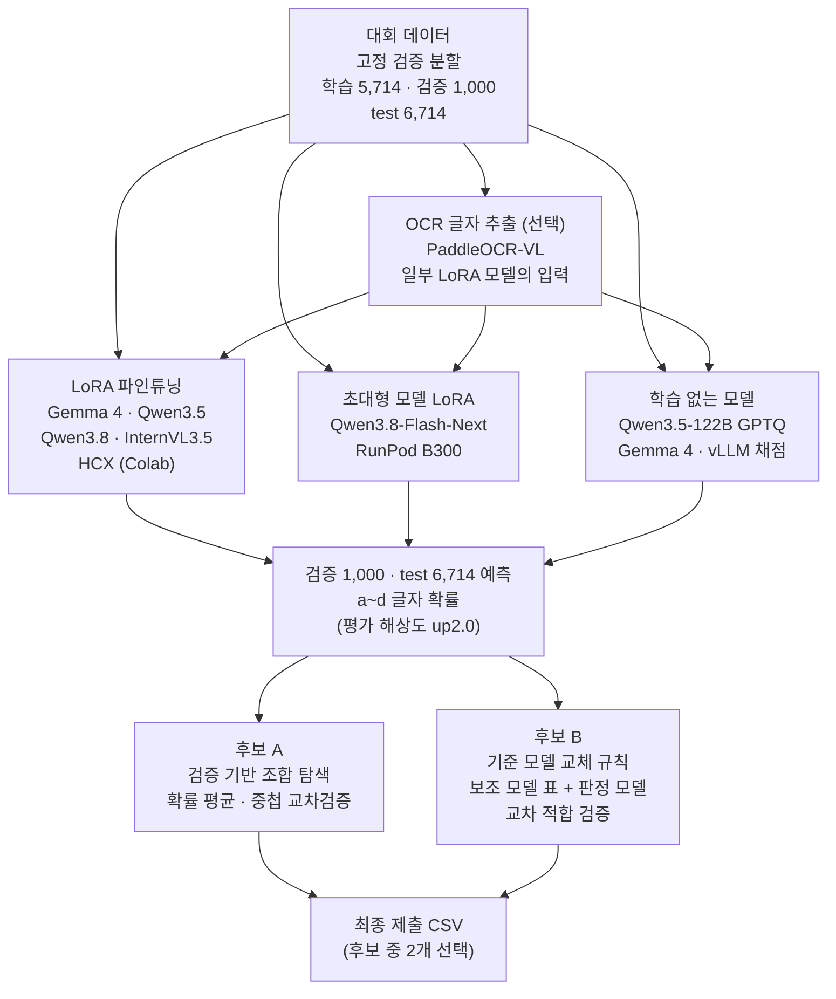

# 텍스트 이미지 VQA — 데이터 처리 및 모델 개발 과정

2026-09-28 · A084 팀

> 대회 제출용 추가 문서(데이터 처리 및 모델 개발 과정)를 마크다운으로 옮긴 것입니다. 원본의 그림 두 개는 Mermaid 다이어그램과 표로 바꿨습니다. 노트북 이름은 `submission_code/` 폴더 기준입니다.

## 1. 개요

이미지 속 글자를 읽고 질문에 맞는 보기(a\~d)를 고르는 4지선다 VQA 과제입니다. 여러 비전-언어 모델을 LoRA로 파인튜닝하고, 각 모델이 낸 a\~d 확률을 검증 1,000문항 기준으로 묶어 최종 답을 정했습니다.

*전체 파이프라인: 여러 모델의 a~d 확률을 검증 기준으로 묶어 최종 답을 정한다.*

모든 모델은 같은 프롬프트, 같은 검증 분할, 같은 채점 방식(답 자리의 a\~d 확률)을 써서 서로 직접 비교할 수 있습니다.

- **후보 A (검증 기반 조합)**: 파인튜닝 모델 5개(Gemma 4 31B 두 종, InternVL3.5-38B, Qwen3.5-27B, Qwen3.8-27B)의 확률을 같은 가중치로 평균합니다. 검증 98.0%, 공개 점수 0.97736이며 최종 제출 첫 번째 파일입니다(ea0e9f).
- **후보 B (기준 모델 교체 규칙)**: Qwen3.8-Flash-Next를 기준 모델로 두고, 보조 모델들의 표가 한 보기로 모이며 기준 모델이 불확실할 때만 답을 바꿉니다. 문턱값은 교차 적합으로 정했습니다. 최종 점수는 두 제출 중 높은 쪽이라 후보 A와 방식이 다른 최종 제출 두 번째 파일로 냈습니다(505d49, 공개 0.97378).
- 평가 지표는 정확도입니다. 공개 리더보드는 test 6,714문항 중 3,357문항으로 채점합니다.

## 2. 데이터 처리

학습에는 대회 train 6,714문항만 썼고, 그중 1,000문항을 고정 검증셋으로 떼어 모든 모델·조합을 같은 문항으로 비교했습니다. 외부 데이터는 쓰지 않았습니다.

| 데이터 | 문항 | 쓰임 |
| --- | --- | --- |
| train − 검증 | 5,714 | LoRA 학습 |
| 고정 검증셋 | 1,000 | 모델 비교, 조합 규칙 선택 (정답 글자별 250문항, 시드 42, 분할 md5 `df05e4bc…`) |
| train 전체 | 6,714 | `_full` 실행만 (제출 파일 섞기용, 검증 점수는 의미 없음) |
| test | 6,714 | 추론만 |
| dev | 2,683 | 정답 없음 → 조건을 모두 만족한 문항만 의사 라벨 |

- **고정 분할**: 모든 노트북이 분할 md5를 확인하고, 다르면 멈춥니다. 같은 문항끼리 비교해 고친 문항·새로 틀린 문항·순이득을 셉니다.
- **이미지**: EXIF 촬영 방향을 보정하고 RGB로 바꿉니다. 해상도는 이름 붙인 프리셋으로 정합니다. native는 원본 크기 수준이고, up2.0은 약 2배로 키웁니다(Qwen·HyperCLOVA X 270만\~340만 픽셀, Gemma 4 소프트 토큰 1,120개, InternVL 448px 타일 12개). 대회 사진은 대부분 720×960이라 작은 글씨를 읽으려고 평가·test는 모두 up2.0으로 했습니다.
- **증강**: epoch마다 보기 순서를 섞고 정답 글자도 맞춰 바꿉니다(자리 편향 제거). 글자를 읽는 과제라 회전·반전·자르기는 쓰지 않았습니다.
- **보조 학습 데이터** (`aux_open_v1.csv`): 학습 문항 중 보기 없이도 답이 정해지고 답이 이미지 글자를 그대로 읽는 문항만 골랐습니다(가격·시간·전화·상호·층·문구). 정답 선지 글자를 단답형 정답으로 씁니다. 보기가 있어야 성립하는 질문, 부정형, 색상, 추론, 개수·계산, 20자 넘는 답은 뺐습니다.
- **dev**: 교육생 응답 5개를 보면 4\~5명이 일치한 문항이 하나도 없고 최다 3표였습니다. 응답만으로는 라벨로 쓸 수 없다고 봤습니다. 그래서 학습한 Gemma 4의 확신이 0.8 이상이고, 3표 이상인 다수결 답과 모델 답이 같은 문항만 의사 라벨로 썼습니다.
- **OCR**: PaddleOCR-VL로 이미지 속 글자 줄과 대략의 위치를 뽑았습니다. 같은 글자가 반복되는 생성 루프 흔적은 정리하고, 1,000자를 넘으면 질문·보기와 겹치는 줄부터 남겨 프롬프트 앞에 붙였습니다(OCR 레시피만).
- **라벨 점검**: 검증 오답을 이미지로 직접 확인했습니다. 1,000문항 중 약 10문항이 라벨 오류이고(예: 간판은 ROCK인데 정답 POP, 브랜드 Johnnie Walker인데 정답 Blue Label), 약 8문항은 두 답이 모두 말이 됩니다. test에도 같은 성격의 문항이 있을 수 있어 학습 라벨은 고치지 않고 원본 그대로 썼습니다.

## 3. 모델 학습

허깅페이스 사전 학습 VLM 7개 계열을 같은 방식의 LoRA로 파인튜닝했습니다. 하나의 통합 학습 노트북(`01_train_vlm`)에 실행 이름을 넣으면 각 실행의 설정이 학습 기록(`train_log.json`)과 같게 재현됩니다.

**기반 모델 고르기**: 후보를 먼저 학습 없이 검증 앞 300문항으로 재고, 한국어 글자 읽기가 약한 모델은 학습하지 않았습니다. 예를 들어 Gemma 4 31B는 97.67%로 가장 높았고 EXAONE 4.5 33B는 85.67%였습니다. 학습 후 정확도는 zero-shot보다 대략 1.1\~1.4%p 올랐습니다.

| 항목 | 설정 |
| --- | --- |
| 학습 목표 | 추론과 똑같은 프롬프트의 마지막 위치(답 자리) 로짓에만 교차 엔트로피, 목표는 정답 소문자 한 글자 |
| LoRA | r 16 · α 32 · dropout 0.05. 언어 모델의 어텐션·MLP 선형층(Qwen3.5 선형 어텐션 투영 포함). 선택으로 비전 블록·투영층에도 붙이고, 그쪽 학습률은 LR × 0.2 |
| 최적화 | AdamW, LR 1e-4(이어학습 2e-5), cosine + warmup 5%, 유효 배치 16, 1 epoch (8B·9B는 2 epoch 중 검증으로 선택) |
| 정밀도 | 20B 이상은 4bit NF4(QLoRA) 또는 bf16. 비전 타워·투영층·lm\_head는 항상 양자화하지 않음 |
| 학습 해상도 | native (Gemma 4 31B만 up2.0이 더 좋아 up2.0) |
| 이어하기 | 50스텝마다 어댑터·옵티마이저·난수 상태 저장, 끊긴 곳부터 같은 결과로 이어 학습 |

**학습 변형** (모두 같은 검증 1,000문항으로 비교했고, 채택 기준은 결과를 보기 전에 정했습니다)

- 정밀도 NF4 → bf16: 같은 시드면 답이 99% 같아 병목이 아니었습니다.
- 비전 LoRA + up2.0 학습 (Qwen3.5-27B 97.3%), 이어학습 + 보기 없는 단답형 보조 손실 20% (97.6%), 학습률·epoch·LoRA 세기 변경 19가지: 단독으로는 비슷하거나 조금 나았지만 앙상블 이득은 −2\~0이었습니다.
- 학습 데이터 양: 3,500문항만으로도 5,714문항과 같은 97.2%였습니다.
- OCR 글자 프롬프트: Gemma 97.5 → 97.7%, Qwen3.5 97.1 → 96.9%로 일관된 이득이 없었습니다. 다만 Gemma OCR 실행은 틀리는 문항이 달라 조합에는 자주 들어갔습니다.

**모델별 처리** (자세한 내용은 `MODEL_NOTES.md`)

- **HyperCLOVA X SEED Think 32B**: 그대로 두면 답 자리에서 생각 블록을 쓰기 시작합니다. 템플릿 변수 `thinking=False`를 넘기고, 열린 채 끝나는 `<think>`를 `</think>`로 닫아 다음 토큰이 곧 답 글자가 되게 했습니다. transformers 개발 버전(검증한 커밋)이 필요합니다.
- **Gemma 4**는 이미지당 소프트 토큰 수로, **InternVL3.5**는 448px 타일 개수로 해상도를 맞췄습니다. **Qwen3.5 이후**는 선형 어텐션 커널(flash-linear-attention)을 설치해야 OOM이 나지 않습니다.
- **Qwen3.8-Flash-Next** (RunPod B300 1장, bf16): 패딩 자리의 전부 가려진 어텐션 행 때문에 역전파가 NaN이 되던 문제를 학습 중에만 풀어 넘겨 막았습니다. 희소 어텐션 토큰 선택은 벡터화했고, 95GiB n-gram 임베딩 표는 CPU RAM에 두었습니다. 각 보정은 작은 모델로 원래 구현과 결과가 같은지 대조했습니다.

## 4. 추론

모든 모델은 문장을 생성하지 않고 **답 자리 토큰 하나의 확률**로 답합니다. 그래서 질문마다 a\~d 네 보기의 확률이 남고, 이 확률이 조합의 재료가 됩니다.

- **채점**: 답 자리 로짓에서 a·b·c·d의 변형 토큰(대문자, 앞 공백 포함) 확률을 합치고 네 보기로 정규화합니다. 네 글자 확률의 합(letter\_mass)이 모든 학습 모델에서 1.000이라 답 자리가 맞는지 확인할 수 있습니다.
- **해상도**: 검증·test 모두 up2.0입니다. 보기 순열 4가지의 평균(TTA)과 애매한 문항만 더 높은 해상도(3배·4배)로 다시 채점하는 방법도 시험했지만 검증·공개 점수에서 이득이 없어 쓰지 않았습니다.
- **학습 없이 쓰는 대형 모델** (vLLM 0.30): Qwen3.5-122B-A10B는 허깅페이스의 사전 양자화 체크포인트(GPTQ-Int4)를 그대로 썼고 Gemma 4 31B는 bf16입니다. 프롬프트·분할·해상도·채점은 학습 모델과 같고, 답 자리 상위 64개 로그확률에서 a\~d를 모읍니다. 이미지는 transformers 전처리와 같은 크기로 미리 맞춰 넘겨 두 경로의 픽셀이 같은지 확인했습니다. 검증 정확도는 122B 96.0%, Gemma 97.0%입니다.
- **판정 모델 (교차 검증)**: 기준 모델과 보조 모델의 답이 갈린 문항만 대상입니다. 이 목록은 정답을 보지 않고 정합니다. 두 후보 답을 ‘모델 A/B의 답’으로 보여 주고(자리는 문항마다 무작위), 근거의 모순을 확인하고 흔한 착각을 배제한 뒤 단계별로 결론을 내게 합니다. 문항마다 표본 5개(temperature 0.7)의 다수결이 그 모델의 한 표이고, 읽은 표본이 3개 미만이거나 동점이면 기권합니다. 프롬프트와 생성 설정은 결과를 보기 전에 고정했습니다.
- **하드웨어 대응**: B300에서는 FlashInfer 즉석 컴파일이 지원되지 않아 Triton 어텐션·MoE 커널로 바꿨고, Colab G4에서는 선형 어텐션 커널을 Triton판으로 고정했습니다. 결과에는 영향이 없는 설정입니다.

## 5. 앙상블과 교체 규칙

조합 방법은 **검증 1,000문항만으로** 골랐고, 고른 과정 자체가 검증에 과적합되는지를 중첩 교차검증으로 따로 재었습니다. 공개 리더보드는 확인용으로만 썼습니다. 여러 파일 중 공개 최고를 고르면 점수가 부풀려지기 때문입니다.

**조합 검색** (`05_ens_search`)

- 멤버: 고정 분할로 학습하고 검증·test 예측이 모두 있는 실행입니다. 검증을 학습에 쓴 `_full` 실행과 검증 99% 초과 실행은 뺐습니다.
- 결합 방식 3가지(확률 평균 / 멤버별 온도 보정 후 평균 / 로그확률 평균) × 검색 방법 3가지를 썼습니다. 검색 방법은 같은 가중치 부분집합 전수(설정마다 약 70만 조합), 그리디, 좌표 상승입니다. 온도는 검증 NLL이 최소가 되도록 맞췄습니다.
- 중첩 CV(5겹 × 4번): 800문항으로 검색하고, 남은 200문항으로 채점합니다. 전수 검색 상위 조합은 검증 98.0%였지만, 같은 방법의 중첩 CV는 97.53%였습니다. 1,000문항에서 고른 최고값이 약 0.5%p 부풀려져 있다는 뜻입니다.
- 제출 후보 `ea0e9f`: Gemma 4 bf16 + Gemma 4 OCR + InternVL3.5 + Qwen3.5 bf16 + Qwen3.8(NF4)의 같은 가중치 확률 평균입니다. 멤버 5개가 모두 다른 실행이고 계열도 4개입니다.

**기준 모델 교체 규칙** (`06_anchor_rescue`)

- 기준 모델(Flash-Next 학습 모델)의 답은 네 조건을 모두 만족할 때만 바꿉니다.
  1. 보조 모델이 다른 보기를 고름
  2. 기준 최고 확률 < CONF
  3. 기준 1·2위 확률 차 < MARGIN
  4. 보조 모델 AGREE개 이상이 같은 다른 보기를 고름
- 보조 모델은 계열별 최고 학습 모델 4개와 zero-shot 대형 모델이고, 판정 모델은 한 표씩 더합니다. 기준 확률은 온도 보정 뒤 문턱값과 비교합니다.
- 문턱값(CONF × MARGIN × AGREE 격자)은 5겹 교차 적합으로 고릅니다. 4구역에서 고르고, 고를 때 쓰지 않은 구역에서만 살린 문항과 망친 문항을 셉니다.
- 채택 기준은 결과를 보기 전에 정했습니다. 네 가지를 모두 만족해야 합니다.
  - 순이득 ≥ +10
  - 살림 ≥ 망침 × 2
  - 부트스트랩 1,000번 중 95% 이상에서 이득
  - 5구역에서 고른 문턱값이 비슷함
- 보조 모델을 하나씩 뺐을 때의 기여도 같은 교차 적합으로 재고 부호 검정을 합니다. 모델 묶음(판정 모델 전부, zero-shot 전부)을 뺐을 때도 같은 방식으로 재를 수 있습니다.

| 실행 | 보조 모델 | 살림 | 망침 | 순이득 | 부트스트랩 | 판정 |
| --- | --- | --- | --- | --- | --- | --- |
| `a12cf3` | 학습 4 + zero-shot 2 | 7 | 3 | +4 | 88% | 불채택 |
| `19f20f` | 학습 4 + zero-shot 1 | 6 | 4 | +2 | 70% | 불채택 |

판정 모델을 더한 결과는 같은 절차로 따로 판정합니다. 확신도 조율(온도 보정 평균, 순위 투표, 마진 가중)은 검증 절반에서 온도를 맞추고 나머지 절반에서 비교했습니다.

## 6. 실험 결과

단독 모델은 검증 95.7\~97.7%였고, 서로 다른 계열 5개를 같은 가중치로 평균한 조합이 98.0%(공개 0.97736)로 가장 높았습니다. 최종 제출은 이 조합(ea0e9f)과 교체 규칙 파일 505d49(공개 0.97378) 두 개입니다.

**단독 모델은 95.7~97.7%** — 고정 검증 1,000문항 · up2.0. 제출 조합 `ea0e9f`는 98.0%.

| 실행 | 종류 | 검증 정확도 (%) |
| --- | --- | ---: |
| Gemma4-31B OCR bf16 | 학습 | 97.7 |
| Gemma4-31B | 학습 | 97.6 |
| Qwen3.5-27B 이어학습+보조 | 학습 | 97.6 |
| Gemma4-31B bf16 | 학습 | 97.5 |
| Gemma4-31B +dev | 학습 | 97.4 |
| Qwen3.5-27B 비전 LoRA | 학습 | 97.3 |
| Qwen3.5-27B | 학습 | 97.2 |
| Qwen3.5-27B bf16 | 학습 | 97.1 |
| HCX-32B | 학습 | 97.0 |
| Qwen3.6-35B-A3B bf16 | 학습 | 97.0 |
| Gemma4-31B zero-shot | zero-shot | 97.0 |
| Gemma4-26B-A4B bf16 | 학습 | 96.9 |
| Qwen3.5-27B OCR bf16 | 학습 | 96.9 |
| Qwen3.8-Flash-Next bf16 | 학습 | 96.9 |
| Qwen3.8-27B | 학습 | 96.8 |
| Qwen3.8-27B 시드43 | 학습 | 96.6 |
| Qwen3-VL-8B | 학습 | 96.5 |
| HCX-32B bf16 | 학습 | 96.5 |
| Qwen3.5-9B | 학습 | 96.4 |
| Qwen3.8-27B bf16 | 학습 | 96.3 |
| Qwen3.5-122B zero-shot | zero-shot | 96.0 |
| InternVL3.5-38B | 학습 | 95.7 |
| **조합 `ea0e9f`** | 조합 | **98.0** |

| 제출 | 방법 | 검증 % | 공개 점수 |
| --- | --- | --- | --- |
| `ea0e9f` | Gemma 4 bf16 · Gemma 4 OCR · InternVL3.5 · Qwen3.5 bf16 · Qwen3.8, 확률 평균 | 98.0 | 0.97736 |
| `b47d7c` | 위 조합 + Flash-Next | 97.6 | 0.97676 |
| `majority_vote` | 초기 조합 3개의 다수결 | — | 0.97676 |
| `clean4_qg_hcx` | Qwen3.5 · Qwen3.8 · Gemma 4 · Gemma 4 +dev · HCX(×2) 가중 평균 | 97.7 | 0.97646 |
| `505d49` | Flash-Next 기준 + 보조 모델 표 (교체 규칙) | — | 0.97378 |
| Flash-Next 단독 | 학습 모델 1개 | 96.9 | 0.97110 |

- 공개 점수의 문항 수는 점수 × 3,357입니다. 상위 제출끼리는 2\~3문항 차이인데, 공개 절반에서 약 20문항이 갈리므로 운만으로 ±4\~5문항은 흔합니다.
- 채택하지 않은 실험: 학습 변형 19가지, 보기 순열 TTA, 애매한 문항 고해상도 재채점, 보기별 예/아니오 검증, 검증 포함 재학습으로 교체, 전 멤버 평균. 모두 검증 순이득이 0 이하였거나 공개 점수가 2\~7문항 떨어졌습니다.
- 검증 오답 20여 개 중 약 10개는 라벨 오류이고 약 8개는 답이 둘 다 되는 문항이라, 조합으로 더 고칠 수 있는 여지는 멤버 의견이 갈리는 문항 몇 개뿐이었습니다.

## 7. 재현 방법

제출 CSV는 저장된 멤버 예측 파일과 설정 JSON만으로 난수 없이 다시 만들어집니다. 모델까지 다시 만들 때는 통합 학습 노트북에 실행 이름만 넣으면 됩니다.

| 순서 | 노트북 | 환경 | 하는 일 |
| --- | --- | --- | --- |
| 0 | `00_data_prep` · `00b_ocr_paddle` | CPU · GPU | 데이터 점검, 고정 분할 확인, 보조 학습 데이터, OCR |
| 1 | `01_train_vlm` | A100 80GB · G4 96GB | 학습 모델 전부 (`RECIPE` = 실행 이름) |
| 2 | `02_runpod_flashnext_bf16` | RunPod B300 | Flash-Next 학습 |
| 3 | `03a_zs122b_vllm_colab` · `03b_runpod_zs_any` | G4 · B300 | zero-shot 대형 모델 |
| 4 | `04_runpod_xcheck_any` | B300 | 판정 모델 (답이 갈린 문항만) |
| 5 | `05_ens_search` · `06_anchor_rescue` | CPU | 조합 · 교체 규칙 → 제출 CSV + 설정 JSON |
| 6 | `07_final_check` | CPU | 고른 CSV의 형식 점검 + JSON만으로 다시 만들어 대조 |

- **고정한 것**: 검증 분할(시드 42, md5 확인), 학습 시드(문항 순서·보기 섞기·LoRA 초기값), 판정 모델의 문항별 시드, 라이브러리 버전(transformers 5.17.0 · HyperCLOVA X만 개발 버전 커밋, peft 0.21.0, bitsandbytes 0.50.2, vLLM 0.30.0).
- **재현 3단계**
  1. 저장된 예측 → 제출 CSV: `07_final_check`가 독립 코드로 다시 계산하고 멤버 파일 md5를 대조합니다. 결과는 완전히 같아야 합니다.
  2. 저장된 어댑터 → 예측: `01_train_vlm`에서 `REUSE_FINISHED = True`로 검증 일부를 새로 채점해 저장된 예측과 비교합니다.
  3. 처음부터 재학습: `RUN_SUFFIX = "_repro"`로 같은 레시피를 다시 학습합니다. GPU 커널의 비결정성 때문에 답이 소수 다를 수 있습니다. 정밀도만 다른 같은 시드 모델도 답이 99% 같았습니다.
- **코드 점검**: 통합 학습 노트북은 작은 모델(CPU)로 9개 경로를 끝까지 돌려 보았습니다(점검 실행, 본 학습, 비전 LoRA, 이어학습+보조 학습, OCR, 기록 대조, 전체 데이터, dev 의사 라벨, 중단 후 이어하기). 중단 후 이어 학습한 결과는 한 번에 학습한 결과와 같았습니다.

## 8. 한계와 배운 점

가장 큰 제약은 라벨 노이즈와 작은 검증셋이었습니다. 모델을 바꾸는 것보다, 무엇이 진짜 개선인지 가려내는 절차가 더 중요했습니다.

- **천장은 라벨이 정합니다**: 검증 오답의 절반 이상이 라벨 오류거나 답이 둘 다 되는 문항이고, 멤버 전부가 같은 오답을 확신합니다. 단독 성능이 좋아져도 이런 문항은 움직이지 않았습니다.
- **검증 1,000문항은 작았습니다**: 오답이 20여 개라 ±3문항 차이는 우연과 구별하기 어렵습니다. 학습은 3,500문항이면 충분했으므로, 검증을 더 크게 두거나 2겹 교차 예측으로 train 전체를 검증에 쓰는 설계가 나았을 것입니다.
- **같은 문항 비교와 미리 정한 규칙**: 고친 문항·새로 틀린 문항으로 판정하고 채택 기준을 결과 전에 정하자, 단독으로만 좋아 보이는 변형을 걸러낼 수 있었습니다.
- **최고값은 부풀려집니다**: 조합 수십만 개 중 검증 1등은 중첩 CV에서 약 0.5%p 낮았고, 공개 리더보드에서도 여러 파일 중 최고를 고르면 같은 일이 생깁니다. 그래서 방법의 값은 중첩 CV·교차 적합으로 따로 재었습니다.
- **정밀도는 병목이 아니었습니다**: 같은 시드의 NF4와 bf16 모델은 답이 99% 같았습니다. 사전 양자화된 체크포인트(GPTQ-Int4)로 초대형 모델을 직접 양자화 없이 쓸 수 있었습니다.
- **다양성이 이득을 만듭니다**: 조합에 들어간 멤버는 단독 순위보다 틀리는 문항이 다른 모델이었습니다. InternVL(95.7%)과 OCR 모델이 그 예입니다. 같은 계열의 변형을 더해도 이득이 거의 없었습니다.
- **하드웨어마다 보정이 필요했습니다**: 최신 GPU(B300)에서는 역전파 NaN, 즉석 컴파일 실패 같은 문제가 있었습니다. 보정마다 작은 모델로 원래 구현과 결과가 같은지 대조한 뒤 썼습니다.
